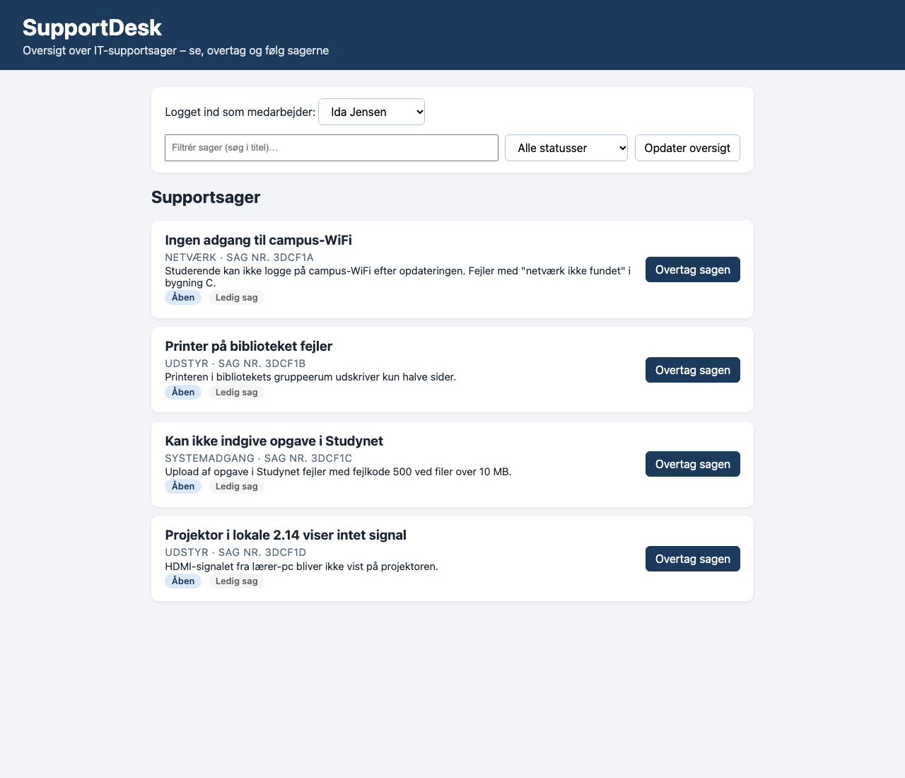
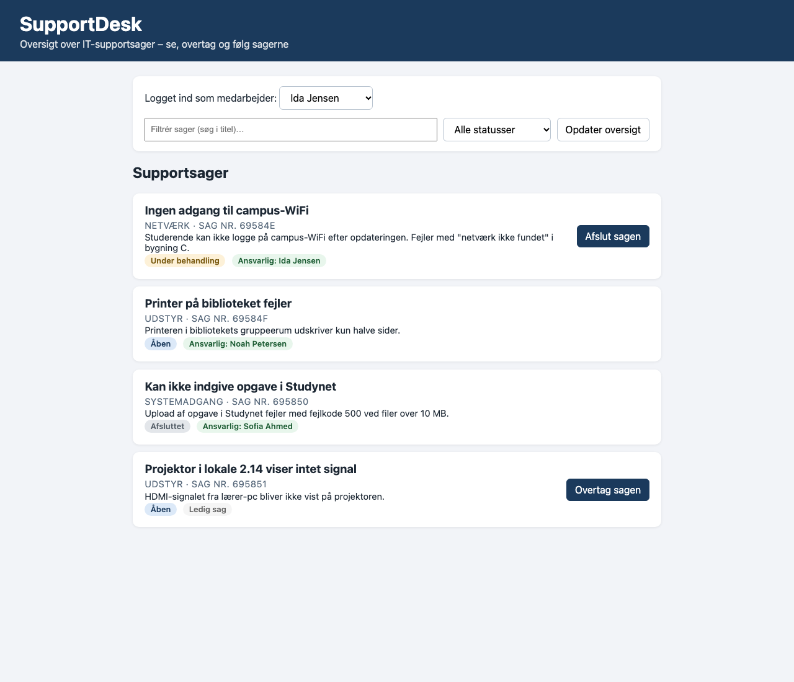

# SupportDesk

Prototype til håndtering af IT-supportsager på en uddannelsesinstitution.
Løser casens kerneproblem: **to medarbejdere må aldrig overtage den samme sag** – og supportafdelingen skal kunne følge en sag fra åben til afsluttet.

Teknologi: **Node.js, Express, MongoDB (Mongoose), HTML/CSS/JavaScript, Vitest + Supertest**.

---

## Kør projektet

```bash
npm install
npm start          # http://localhost:3000  (frontend + API)
npm test           # kører alle 14 tests incl. PO's to accepttests
npm run demo:concurrency   # demonstrerer krav 3 over HTTP
```

- Uden `MONGO_URI` startes automatisk en **MongoDB i hukommelsen** (mongodb-memory-server) – praktisk til demo og test.
- I drift: sæt `MONGO_URI`, f.eks. `MONGO_URI=mongodb://localhost:27017/supportdesk npm start`. Data gemmes i MongoDB og overlever genstart (krav 6).
- En tom database fyldes automatisk med 3 medarbejdere og 4 supportsager (krav 1: mindst tre sager). Nulstil med `npm run seed`.

## Skærmbilleder

**Oversigt over supportsager** – alle fire sager er åbne og ledige ("Overtag sagen"):



**Sagsforløb** – samme oversigt efter, at Ida har sat WiFi-sagen under behandling, Noah har overtaget printer-sagen (stadig åben, men tildelt), og Sofia har afsluttet Studynet-sagen. Status, ansvarlig og tilgængelige handlinger afspejler sagens fase:



## Arkitektur

```text
Browser (HTML/CSS/JS, fetch)
        │  HTTP / JSON
        ▼
Express-app (src/app.js)  ──  øverste fejl-middleware (ingen crash)
  ├─ /api/tickets      ruter + validering
  ├─ /api/assignments  atomisk overtagelse
  ├─ /api/employees    medarbejderliste
  └─ ensureConnected()  ── Mongoose ──► MongoDB
```

- `src/app.js` eksporterer Express-appen **uden** at starte serveren – det er kontrakten til PO's tests (Supertest importerer appen direkte).
- `src/server.js` starter HTTP-serveren og DB-forbindelsen.
- `src/models/` – Mongoose-modeller: `Ticket` (status + én ansvarlig), `Employee`, `Assignment` (journal over gennemførte overtagelser).
- `src/db.js` – forbindelse, memoizeret `ensureConnected()` og status-flowet `open → in_progress → closed`.
- `public/` – brugergrænsefladen, der taler med API'et udelukkende via `fetch` (GET/POST/PATCH, HTTP-statuskoder og `error`-feltet vises i UI'et).

## API

| Metode & sti | Funktion | Fejl |
|---|---|---|
| `GET /api/tickets` | Alle sager med status og ansvarlig (`?status=open` filtrerer) | – |
| `GET /api/tickets/:id` | Én sag | 404 hvis den ikke findes |
| `POST /api/tickets` | Opret sag | 400 hvis titel mangler |
| `PATCH /api/tickets/:id/status` | Skift status `{status, employeeId}` – kun den ansvarlige, kun `open→in_progress→closed` | 400/403/404 |
| `POST /api/assignments` | Overtag sag `{ticketId, employeeId}` | 400/404/409 |
| `GET /api/assignments` | Journal over gennemførte overtagelser | – |
| `GET /api/employees` | Medarbejdere | – |

Alle fejl returneres som `{ "error": "..." }` med en forståelig dansk besked og **den korrekte HTTP-status** (400 ugyldige data, 404 findes ikke, 403 forbudt, 409 konflikt). Serveren crasher aldrig på grund af disse fejl (krav 5).

## Sådan håndteres samtidighed (krav 3)

Ida og Noah rammer samme ledige sag på samme tid. Overtagelsen udføres som **ét atomisk databasekald**:

```js
Ticket.findOneAndUpdate(
  { _id: ticket._id, assignedTo: null },   // matcher KUN hvis sagen stadig er ledig
  { $set: { assignedTo: employee._id, assignedAt: new Date() } },
  { new: true }
);
```

MongoDB garanterer, at betingelsen og opdateringen sker i én udelelig operation. Selv når flere requests kommer samtidig, kan kun ét kald se `assignedTo: null` og vinde – alle andre får HTTP 409 med beskeden *"Sagen er allerede overtaget af en anden medarbejder."* Ingen låse eller køer er derfor nødvendige, og der kan aldrig opstå dobbelte ansvar (race condition er elimineret i databasen, ikke i Node-processen).

**Demonstration:** `npm run demo:concurrency` starter serveren og sender tre parallelle overtagelser (Ida, Noah, Sofia) af samme sag. Forventet output: 1 × `201 FIK SAGEN`, 2 × `409 AFVIST`, og databasen har præcis én ansvarlig. Denne situation er også automatiseret i `tests/extra.test.js` ("Krav 3"). Faktisk output fra en kørsel:

```text
=== Simultan overtagelse af sagen "Ingen adgang til campus-WiFi" (id 6b06a873e143e7d210d031d8) ===
Ida, Noah og Sofia rammer alle sagens POST /api/assignments på præcis samme tid:

Ida Jensen      HTTP 201 ✓ FIK SAGEN
Noah Petersen   HTTP 409 ✗ AFVIST: Sagen er allerede overtaget af en anden medarbejder.
Sofia Ahmed     HTTP 409 ✗ AFVIST: Sagen er allerede overtaget af en anden medarbejder.

Resultat i databasen: Ida Jensen har ansvaret.
✔ Præcis én medarbejder fik ansvaret – krav 3 er opfyldt.
```

## Tests

```bash
npm test
```

- `tests/api.test.js` – **product owners to accepttests, uændrede**.
- `tests/extra.test.js` – 12 tests der dækker examens testscenarier:

| Testscenarie | Forventet resultat | Dækket af |
|---|---|---|
| Hent supportsager | Viser sager og status | `viser mindst tre tickets`, `viser sager med status og ansvarlig` |
| Overtag ledig sag | Overtagelse gennemføres og gemmes | `gennemfører en overtagelse...`, `assignment-journalen` |
| Overtag tildelt sag | Afvises (409) | `afviser overtagelse af en allerede tildelt sag` |
| Ugyldige oplysninger | Håndteres korrekt (400) | PO-test 2, `afviser ukendt medarbejder`, `afviser ugyldig statusværdi` |
| To samtidige overtagelser | Kun én får sagen | `Krav 3-testen` med 3 parallelle POSTs, + `npm run demo:concurrency` |
| Opdatér status | Ny status gemmes og vises | `gennemfører forløbet åben → under behandling → afsluttet` |
| Afslut en sag | Fremstår som afsluttet | samme test: den findes ikke længere under `?status=open` |

Alle 14 tests består (`Vitest`, 2 filer). Der køres med en MongoDB i hukommelsen, så testene er uafhængige af en lokal database.

## Arbejdsform (GitHub Projects/Issues)

Udviklingsarbejdet organiseres med GitHub Projects (backlog → in progress → review → done) med Issues svarende til leverancerne:

1. Opsæt projekt (Node/Express/Mongo, mappestruktur) – arkitektur Issue
2. Datamodel + seed (krav 1, 6)
3. Overtagelse med atomisk opdatering (krav 2, 3)
4. Statusflow (krav 4)
5. Fejlhåndtering (krav 5)
6. Frontend
7. Tests incl. samtidighedstest og demo

Hver Issue lukkes med commit(s), der henviser til Issue-nummeret (`#3` f.eks.), og feature-branches merges til `main`.

## Eksamination: svar på de forventede spørgsmål (opgavens pkt. 8)

### 1. Forklare og demonstrere dele af koden

Vigtigste fil at gennemgå er overtagelsen i `src/routes/assignments.js`: validering af `ticketId`/`employeeId`, kontrollen af at sagen findes og ikke er afsluttet, og til sidst det atomiske `findOneAndUpdate`, der afgør kapløbet. Statusflowet ligger i `src/routes/tickets.js` (`PATCH /:id/status`): tjek af gyldig status, at kun den ansvarlige må ændre (`403`), og at overgangen findes i `ALLOWED_TRANSITIONS` i `src/db.js`. Demonstration: `npm start` + browseren, eller dens samme ark via Postman/kommandoer fra README.

### 2. Hvordan kommunikerer frontend og backend gennem HTTP?

Frontend er ren HTML/CSS/JS uden framework. Al kommunikation går gennem `fetch` i `public/app.js` mod stierne `/api/tickets`, `/api/assignments` og `/api/employees`:

- `GET` henter JSON (oversigten gendannes efter hver handling),
- `POST /api/assignments` sender `{ ticketId, employeeId }` som JSON-body,
- `PATCH /api/tickets/:id/status` sender `{ status, employeeId }`.

Backendens svar er altid JSON; fejl har formen `{ "error": "besked" }` med en HTTP-status (`400/403/404/409/500`). Frontenden tjekker `res.ok`, viser `error`-feltet som en rød besked i UI'et og opdaterer oversigten bagefter, så brugeren ser den nyeste virkelighed. `Content-Type: application/json` sættes på alle kald.

### 3. Hvorfor denne arkitektur og disse teknologier?

Lag-inddeling: **ruter** (HTTP + validering) → **modeller** (Mongoose-skemaer, databaselogik) → **frontend** (kun præsentation). Fordel: hver del kan testes og forklares isoleret, og frontend kan udskiftes (f.eks. med en app) uden at røre API'et.

- **Express**: de-facto standard, minimal boilerplate, middleware-kæde passer godt til fejlhåndtering i ét punkt.
- **MongoDB/Mongoose**: casens data er dokument-orienterede (én sag = ét dokument med ansvarlig og status), og Mongo giver atomare betingede opdateringer på ét dokument – præcis det, samtidighedsløsningen kræver, uden transaktionskompleksitet.
- **Vitest/Supertest**: tester HTTP-kontrakten (de samme kald Postman/browseren laver), ikke kun interne funktioner.
- `ensureConnected()` initialiserer DB ved første kald, så `src/app.js` kan eksporteres uden at igangsætte server eller DB – det er selve kontrakten i PO's tests (praktisk: `mongodb-memory-server` gør løsningen afprøvbar uden installeret database; i drift sættes `MONGO_URI`).

### 4. Hvordan har du håndteret samtidighed?

Se afsnittet "Sådan håndteres samtidighed (krav 3)" ovenfor. Kort: **betingelsen og opdateringen er én udelelig databaseoperation**, ikke "læs, tjek, skriv" i Node-processen (hvilket ville være en race condition). MongoDB serialiserer opdateringer på samme dokument: når Ida og Noah rammer samme sag samtidig, ser og vinder præcis ét kald `assignedTo: null`; de andre matcher ikke og får `409`. Løsningen virker også med flere server-processer, fordi garantien ligger i databasen – ikke i hukommelsen. Alternativer: pessimistisk låsning eller en jobkø ville virke, men tilføjer kompleksitet, som casen ikke kræver; ACID-transaktioner er unødvendige, da kun ét dokument berøres.

### 5. Hvordan reagerer systemet på fejl?

Alle ruter kaster `ApiError` med status + dansk besked; den centrale fejl-middleware i `src/middleware/errors.js` oversætter desuden Mongoose-fejl ( CastError, validering) til `400/404`. Ingen rute lader en undtagelse falde igennem til at crash-processen: Express fanger den, API'et svarer `{ error }`, og allerede registrerede data røres ikke (f.eks. afvises en overtagelse med ukendt medarbejder, *før* noget skrives). Uventede serverfejl logges og returnerer `500` som JSON – systemet er stadig kørende. Demonstration: send `{ ticketId: 'test-id' }` uden `employeeId` → `400`; overtag samme sag to gange → `409`; brug et id der ikke findes → `404`.

### 6. Hvordan har du kvalitetssikret kode udviklet med AI-agenter?

- **Kontrakt-test først**: PO's to accepttests er uændrede og kører ved hver ændring – omskriver AI'en en rute, springer testene op.
- **Egen gennemgang af al agent-genereret kode** før commit: valideringsrækkefølge, at fejlbeskeder ændrer ingen data, og at der ikke er "død" kode eller overflødige grene.
- **Automatiserede tests af de centrale risici** (samtidighed, 409/404/400, statusflow) – ikke kun happy path – så en fejl der er svær at se med øjnene (race condition) bliver synlig og deterministisk.
- **Smoke-test af den virkelige kæde**: browser mod kørende API og `npm run demo:concurrency` mod rigtig HTTP – dokumenteret med output ovenfor og skærmbilleder.

### 7. Alternative løsninger og konsekvenser

- **Låse/kø i Node-processen** (f.eks. en mutex om overtagelsen): enklere at forstå, men virker kun inden for én proces og skalerer ikke til flere servere.
- **ACID-transaktioner i Mongo** (`session.startTransaction()`): påkrævet hvis flere dokumenter skulle opdateres samlet (sag + journal atomisk); her rækker én betinget opdatering, så transaktion ville være over-engineering.
- **Optimistisk versionering** (versionsfelt + retry): muligt, men giver ikke et entydigt "én vinder"-svar pr. kald.
- **PUT frem for PATCH** og fuld ressource-opdatering: mere skrøbeligt – samtidige skrivninger kan overskrive hinanden; PATCH af ét felt med betingelse er smalere og sikrere.
- **Login og autentificering** (JWT/session): casen løser det med en medarbejder-dropdown + `employeeId` i kaldet; i produktion kræves reel autentificering, så man ikke kan udgive sig for andre. Strukturen (token → medarbejder) kan kobles på uden at ændre modellerne.

## Krav-tjekliste

- [x] Krav 1 – oversigt, entydige id'er (MongoDB ObjectId), ledig/overtaget-flag, 4 sager i seed
- [x] Krav 2 – overtagelse knytter medarbejder til sag, journal i `assignments`, én ansvarlig ad gangen, forståelige fejlbeskeder
- [x] Krav 3 – atomisk `findOneAndUpdate`; demonstreret både med automatiseret test og demo-program
- [x] Krav 4 – statusflow `open → in_progress → closed`, kun for den ansvarlige; afsluttet sag er ikke åben
- [x] Krav 5 – 400/403/404/409 med danske fejlbeskeder; ingen data ændres ved afviste handlinger; serveren crasher ikke
- [x] Krav 6 – data i MongoDB; overtager data overlever genstart af appen
- [x] Frontend – se sager, vælge medarbejder, overtage ledig sag, ændre status, se fejlbeskeder
- [x] PO's to accepttests bestået uændrede
